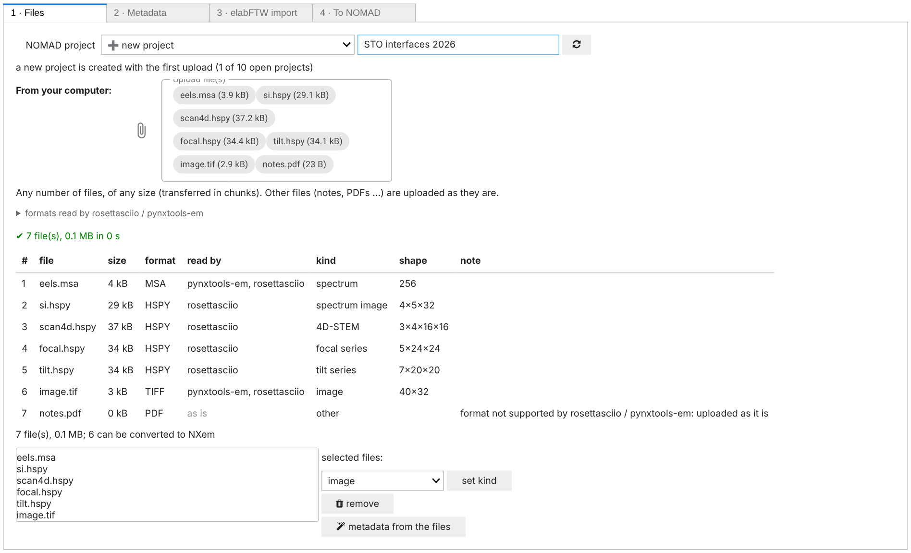
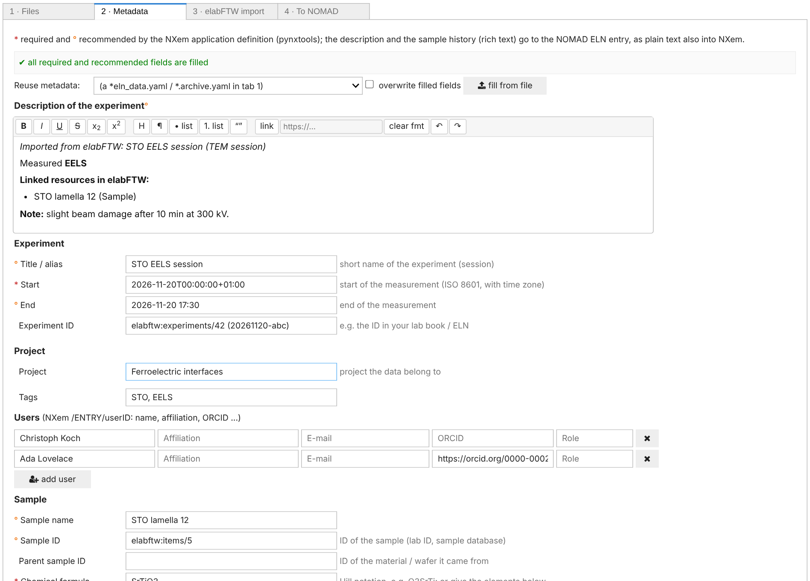
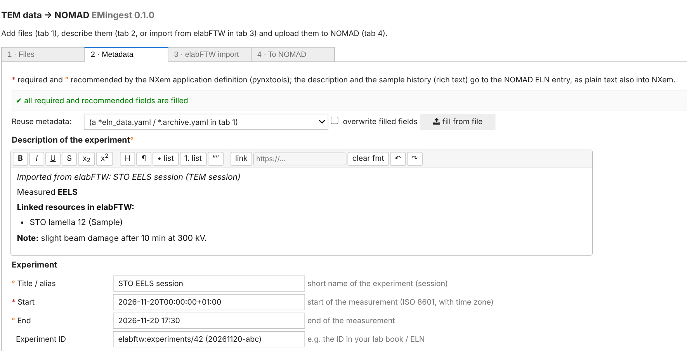
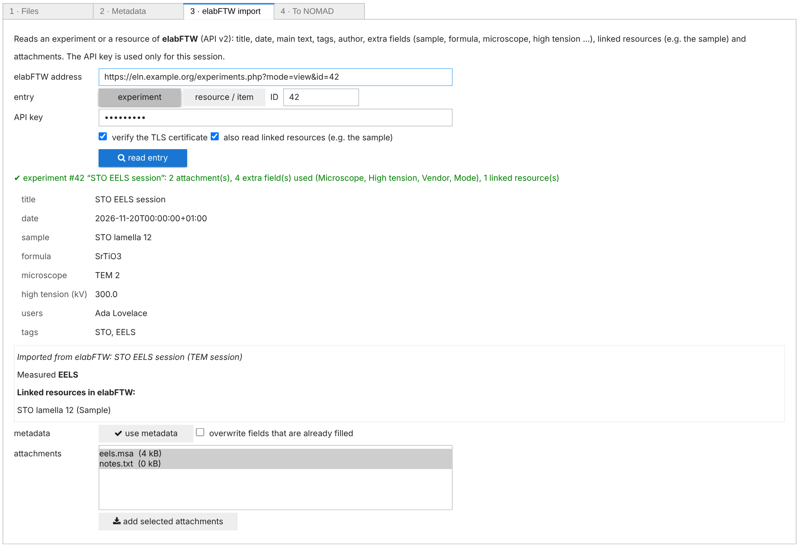
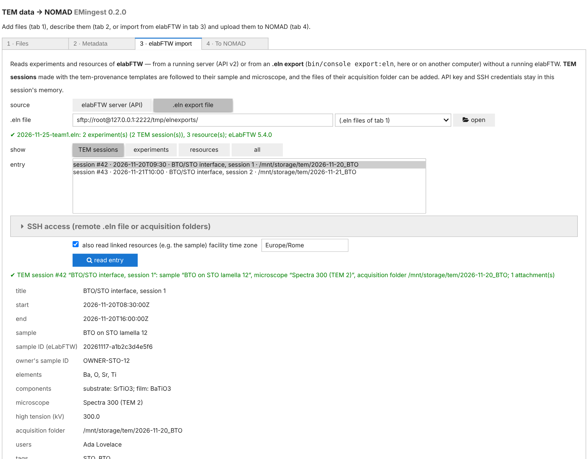
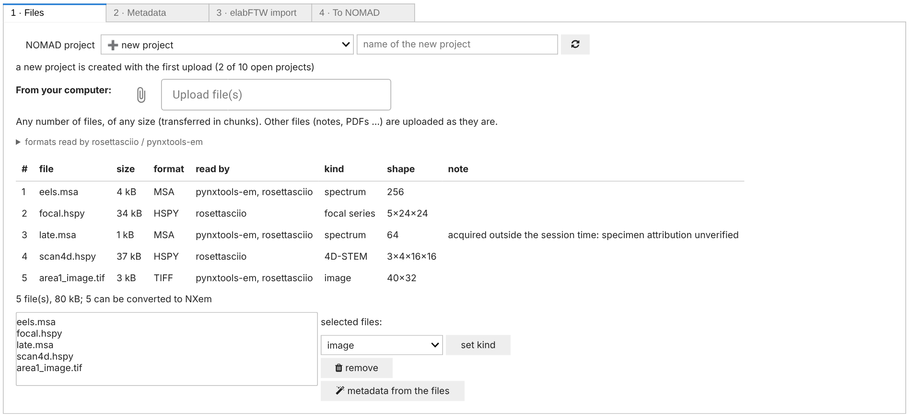
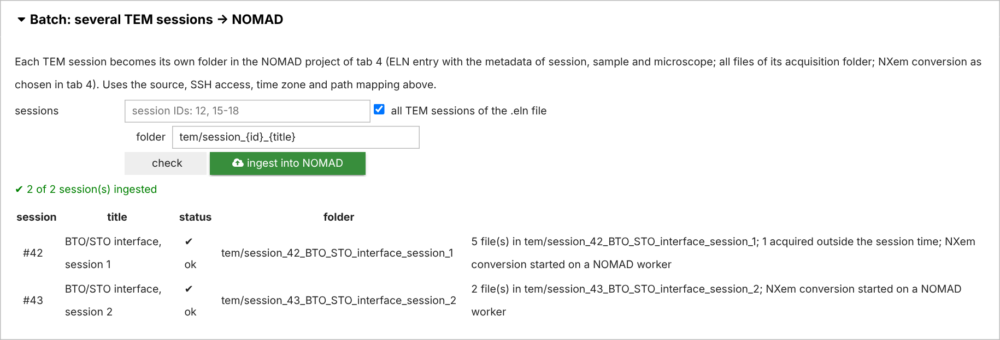
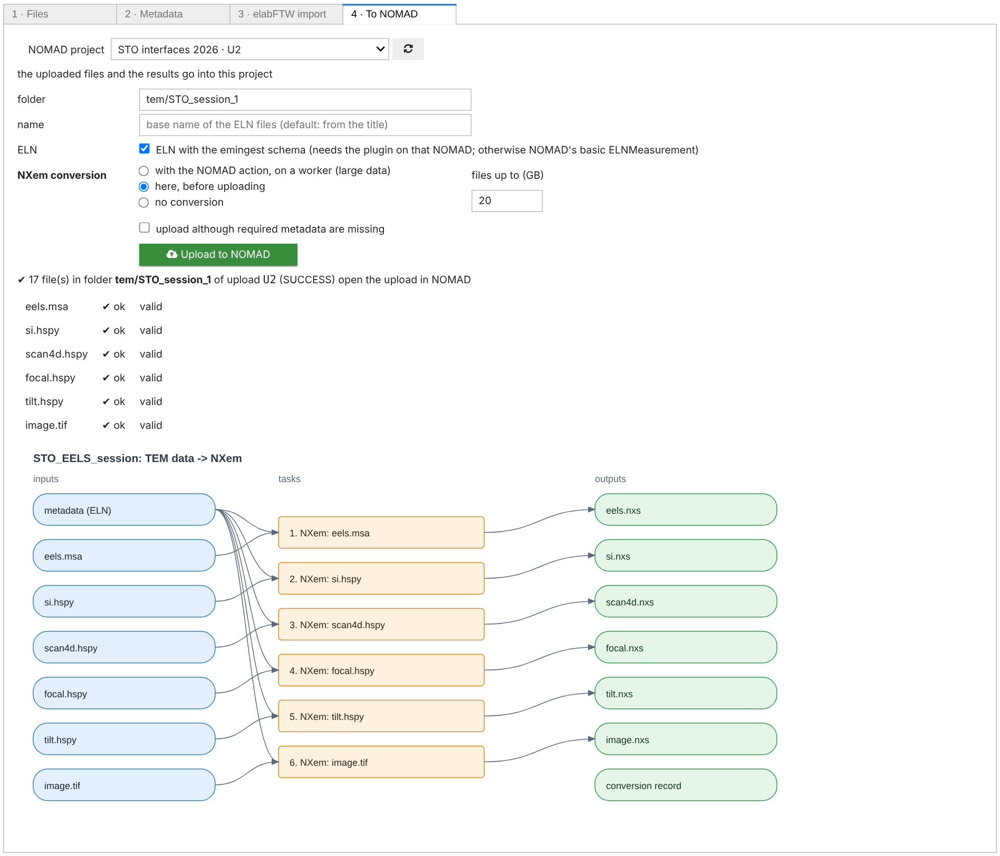
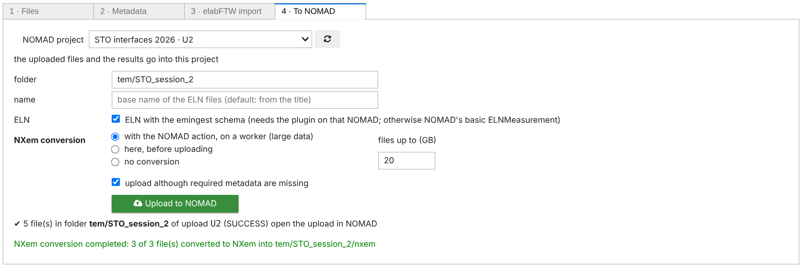

# EMingest

**Bring electron microscopy data of any kind and format into [NOMAD](https://nomad-lab.eu) — with the metadata
that makes it findable and reusable.**

EMingest is a NOMAD plugin (dashboard + action + ELN schema) and a small Python package. In one browser page you

1. **upload** any number of files of any size — images, diffraction patterns, EELS/EDS spectra, focal series,
   tilt series, 4D-STEM data sets, spectrum images … — in every format that
   [rosettasciio](https://hyperspy.org/rosettasciio/) or [pynxtools-em](https://github.com/FAIRmat-NFDI/pynxtools-em)
   can read, and **Nion Swift exports** (`.npy` + `.json`, or both in a `.zip`);
2. **describe** them in a form that follows the NeXus **NXem** application definition, with rich-text fields for
   the experiment and the history of the sample — or **import** all of that from **elabFTW**: from a running
   server or from its `.eln` export (also on another computer, over SSH), including **TEM sessions** that link
   sample, microscope and acquisition folder, one at a time or in **batches**;
3. **store** everything in a NOMAD project, as a NOMAD ELN entry plus the data **converted to NXem**, either
   right away or by a NOMAD **action** on a worker.

The dashboard runs inside NOMAD and uses your NOMAD login; the same app also runs in Jupyter, Voilà or as a
stand-alone web app.

> The screenshots below were taken with the dashboard running inside a NOMAD app, using the synthetic test data of
> this repository and a test elabFTW server.

---

## 1 · Add files



* **NOMAD project:** choose where everything goes — a **new project** (offered as long as you have fewer open
  projects than your NOMAD allows; the count is shown) or one of your existing, unpublished uploads.
* **Upload file(s):** pick as many files as you like; they are transferred in chunks with a progress bar, so
  multi-GB data sets are no problem.
* Every file is opened lazily and classified: **format**, which library **reads** it, the **kind** of data
  (image, diffraction pattern, spectrum, spectrum image, focal series, tilt series, 4D-STEM, …) and its **shape**.
  The kind can be corrected for selected files. Files that no reader understands (notes, PDFs, …) are kept and
  uploaded as they are.
* *metadata from the files* copies high tension, microscope and acquisition time found in the files into the form.

## 2 · Describe the data



* The form contains the fields that **NXem** and pynxtools ask for: `*` **required**, `°` **recommended**. The bar
  at the top lists what is still missing and turns green when everything is filled in.
* **Description of the experiment** — a rich-text editor (bold, italic, headings, lists, links, sub/superscript,
  pasted tables and images). It becomes the description of the NOMAD ELN entry and, as plain text, of the NXem
  files.
* Experiment, project, tags, **users** (name, affiliation, e-mail, **ORCID**, role), sample, instrument (vendor,
  model, type, high tension, electron source, mode, detectors).
* *Reuse metadata* fills the form from an earlier data set (`*.eln_data.yaml` or `*.archive.yaml`).



The **sample** section with its own rich-text field for the **history and preparation** of the specimen.

## 3 · Import from elabFTW



Paste the address of an elabFTW experiment or resource (as shown in your browser) and an API key with read access:

* title, date, main text, tags and author (with ORCID) of the entry;
* **extra fields** recognised by their names — sample, sample ID, chemical formula, elements, preparation date,
  thickness, microscope, vendor, model, high tension, mode, detector, location, project, …;
* the **linked sample** resource: its name, ID, extra fields and main text (→ sample history);
* the **attachments**, which can be added to the files of tab 1.

*use metadata* fills only empty fields (unless *overwrite* is ticked) and appends the elabFTW text to a description
you have already written. The API key stays in the memory of your session; it is never stored or passed on.

### Without a running elabFTW: the `.eln` export

elabFTW exports a team with `bin/console export:eln <team ID>` (or from the export tab of the profile page) into one
`.eln` file — an RO-Crate with all experiments, resources, their extra fields, links and attachments. Choose
**.eln export file** as source and give

* a file added in tab 1, a path on the machine running EMingest, or
* a location on another computer, written like for `scp`: `user@host:/var/elabftw/exports/team1.eln`, or a folder
  (`sftp://user@host:2222/exports/` — the newest `.eln` is taken). EMingest connects over SSH (key, agent or
  password, under *SSH access*) and reads the archive in place, transferring only its index, the metadata and
  the attachments you choose. An unknown host key is shown with its fingerprint to compare and accept.

The entries are listed (TEM sessions, experiments, resources) and imported exactly as from the server.



### TEM sessions (tem-provenance templates)

EMingest understands the eLabFTW workflow of [tem-provenance](https://github.com/erotunno/tem-provenance): a
**Sample** resource registered on arrival, a **TEM Microscope** resource, and a **TEM Session** experiment that links
both and records start and end (facility-local time) and the `Path` of the acquisition folder. Reading a session
follows those links, like tem-provenance's exporter:

* the session's elabid as experiment identifier, start and end converted to UTC (ambiguous local times are refused),
  objective, notes and session record as description, with a provenance note;
* the sample: name, **persistent eLabFTW ID** (`identifier_sample`) and the **owner's sample ID**
  (`identifier_owner`) side by side, the parent sample's elabid, formula, elements from all formulas, **components**
  of multilayer samples (`<name>_formula` / `<name>_space_group` in the *Materials* group), thickness, form,
  preparation date and the reception and preparation record as sample history;
* the microscope: name, vendor, model, identifier, electron source, capability, high tension.

*add the files of the acquisition folder* copies all files of the session's folder into tab 1 — from this computer
or over SSH; a **path mapping** translates the path recorded in eLabFTW (e.g. `/mnt/storage=user@nas:/data`).
Files whose acquisition time lies outside the session are marked (specimen attribution unverified).



### Batch ingestion



*Batch* turns any number of sessions (`12, 15-18`, or all sessions of an `.eln` file) into one folder each in the
NOMAD project: ELN entry, all acquisition files and — as chosen in tab 4 — the NXem conversion. *check* runs
everything except the upload and lists what is missing. The same is available on the command line, e.g. on the
workstation next to the lab storage:

```bash
emingest-ingest --eln elab@eln.lab.org:/var/elabftw/exports/ --all \
                --map /mnt/storage=/data/tem --nomad-url https://oasis.lab.org/nomad-oasis/api/v1 \
                --new-project "TEM sessions 2026"
emingest-ingest --config ../tem-provenance/config.yml 12 15-18        # its eLabFTW / NOMAD settings
emingest-ingest --nxs session-12.nxs --upload-id <id>                 # NXem files written by tem-provenance
```

Keys come from `ELABFTW_API_KEY` / `NOMAD_API_KEY` (as in tem-provenance) or a prompt. Details:
[docs/ELABFTW.md](docs/ELABFTW.md).

## 4 · Upload to NOMAD and convert to NXem



Choose the project and folder and how the data are converted to **NeXus NXem**:

* **with the NOMAD action, on a worker** — recommended for large data; the dashboard follows its progress;
* **here, before uploading** — as above: every file is converted and validated, and the result is shown together
  with the **workflow** that is stored in NOMAD (metadata + data files → one conversion task per file → NXem
  files);
* **no conversion**.



With the action, the files are uploaded first and converted on a NOMAD worker afterwards.

What ends up in the NOMAD project:

```
tem/<session>/
  <data files …>                   as uploaded
  <name>.archive.yaml              NOMAD ELN entry (description, sample + history, instrument, users,
                                   data files with kind / format / shape, link to elabFTW)
  <name>.eln_data.yaml             the metadata for pynxtools
  nxem/<file>.nxs                  one NXem file per data file — NOMAD shows them as electron-microscopy entries
  <name>.nxem.archive.yaml         conversion record: which file gave which NXem file, status, warnings
  <name>.workflow.archive.yaml     the workflow shown above
```

---

## How the NXem conversion works

EMingest registers a pynxtools reader called `tem`:

1. **pynxtools-em** handles every file it knows and keeps the vendor metadata (Thermo Fisher Velox, Gatan, Nion,
   Bruker, EDAX, Oxford, JEOL, Hitachi, Tescan, Zeiss, MRC + mdoc …);
2. for everything else that **rosettasciio** reads (TIA .ser/.emi, Bruker .bcf, Merlin .mib, blockfile, TVIPS,
   DENS, HyperSpy .hspy/.zspy, generic TIFF/PNG …) each signal is written as an NXem event: `image_2d`,
   `image_3d` (focal / tilt / time series), `image_4d` (4D-STEM), `spectrum_0d` … `spectrum_3d` (spectra, line
   scans, spectrum images) — with axes, units and the checksum of the source file;
3. **Nion Swift exports** take the same path (see below);
4. the instrument, sample and user metadata of the form are added (ORCIDs as `identifier_orcid`).

With the required and recommended fields filled in, the NXem files validate without warnings. Each file is
converted in its own process, with limits on size and time, so one broken file does not stop the others.

### Nion Swift exports

Nion Swift exports a data item as `<name>.npy` (data) and `<name>.json` (calibrations and metadata). EMingest takes
both files of the same name together, or a `<name>.zip` that contains them (reading as in `nion2nxs` of
[fit4DSTEM](https://github.com/christophys/fit4DSTEM)):

* the **kind** comes from the dimension counts in the JSON (`collection_dimension_count`,
  `datum_dimension_count`, `is_sequence`), else from the shape: 4D → 4D-STEM, 3D with an energy axis → spectrum
  image, 2D → image …; the scan axes keep their calibration (nm), the camera axes of 4D-STEM are in pixels;
* "metadata from the files" in tab 1 fills the high tension, vendor (Nion), detector and acquisition time;
* the NXem file gets the data with axes and units, the high tension, and for the event the start time,
  semi-convergence angle, field of view and scan rotation (`/ENTRY/measurement/event1/instrument`);
* values are stored **losslessly** in the smallest type: integer counts (also when exported as floats) as
  uint16 / uint32, everything else in the original type; gzip-compressed;
* data larger than 256 MB (`EMINGEST_NION_MAX_MEMORY_MB`) are not loaded: they are streamed into the NXem file row
  by row, also out of a zip, so multi-GB 4D-STEM scans convert with little memory. The `.json` itself is uploaded
  next to the data.

## Install

**In NOMAD (nomad-distro-dev):**

```bash
cd nomad-distro-dev
git submodule add https://github.com/christophys/EMingest.git packages/EMingest
uv add packages/EMingest --extra nomad
uv sync
uv run poe start          # NOMAD;   second terminal:  uv run poe cpuworker   (runs the conversion action)
```

Then open *Dashboards → TEM data upload* in the NOMAD GUI. Details (environment variables, the action's API,
what the schema contains): [docs/NOMAD_PLUGIN.md](docs/NOMAD_PLUGIN.md).

**Without NOMAD:**

```bash
pip install "emingest[formats,remote] @ git+https://github.com/christophys/EMingest"
```

* Jupyter / Voilà: [`notebooks/emingest_app.ipynb`](notebooks/emingest_app.ipynb)
  (`from emingest.app import show; show()`) — uploads to any NOMAD with an API token;
* stand-alone web app: `solara run webapp/solara_app.py` (needs the `web` extra);
* Python / command line:

  ```python
  from emingest import convert, formats, metadata

  formats.inspect_file("scan.mib")["kind"]          # '4D-STEM'
  m = metadata.empty()
  m["entry"]["start_time"] = "2026-11-20 10:00"
  m["sample"].update(name="STO lamella", chemical_formula="SrTiO3", preparation_date="2026-11-01")
  m["instrument"].update(vendor="JEOL", model="ARM200F", voltage_kV=200)
  metadata.write_eln_data(m, "s1.eln_data.yaml")
  convert.convert_all(["a.dm4", "b.emd", "c.hspy"], "s1.eln_data.yaml", "nxem/")
  ```

  ```bash
  dataconverter --reader tem --nxdl NXem a.dm4 s1.eln_data.yaml --output a.nxs
  ```

## Repository

| | |
|---|---|
| `emingest/formats.py` | format and kind of a file, grouping of sidecar files (`.mdoc`, `.hdr`, `.json` …) |
| `emingest/nion.py` | Nion Swift exports (`.npy` + `.json`, `.zip`): metadata, lossless types, streaming |
| `emingest/metadata.py` | the form's fields (NXem required / recommended), checks, `eln_data.yaml` |
| `emingest/richtext.py` | rich-text editor widget, HTML sanitising, HTML → text |
| `emingest/elabftw.py` | elabFTW API v2 client and mapping to the form |
| `emingest/eln_archive.py` | elabFTW `.eln` exports (RO-Crate) with the interface of the API client |
| `emingest/remote.py` | files and folders on other computers over SSH / SFTP |
| `emingest/tem_session.py` | TEM sessions of the tem-provenance templates |
| `emingest/ingest.py`, `cli.py` | headless pipeline, batch ingestion, `emingest-ingest` |
| `emingest/nx_reader.py` | the pynxtools reader `tem` |
| `emingest/convert.py` | NXem conversion (one process per file, size and time limits) |
| `emingest/eln.py` | NOMAD ELN entry, conversion record and workflow |
| `emingest/nomad.py`, `nomad_project.py` | NOMAD API client, project choice, streamed uploads |
| `emingest/app.py` | the app (ipywidgets) |
| `emingest_nomad/` | NOMAD plugin: dashboard, action (Temporal workflow), schema |
| `tests/` | synthetic data of every kind, mock NOMAD and elabFTW servers, `.eln` exports, an SSH server, the action on a Temporal dev server |

Run the tests with `pytest tests`.

## Related

[inlineHolo](https://github.com/christophys/inlineHolo) (inline electron holography) and
[fit4DSTEM](https://github.com/christophys/fit4DSTEM) (4D-STEM CBED fitting) are NOMAD dashboards of the same
kind and can be installed in the same NOMAD.

## License

BSD 3-Clause, see [LICENSE](LICENSE).
