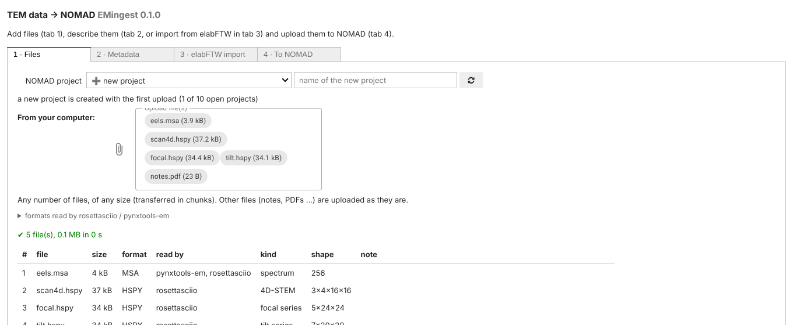
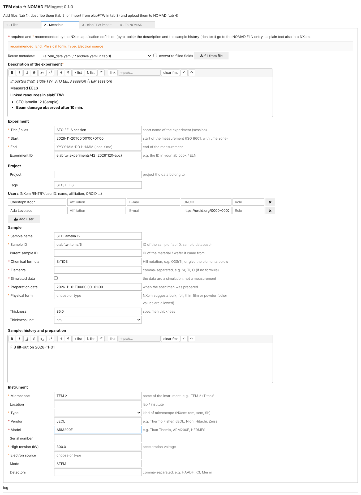
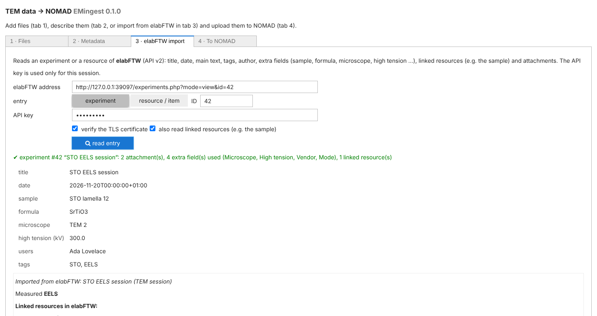
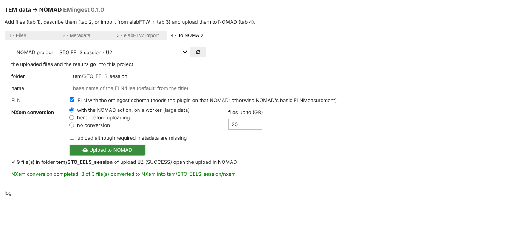

# EMingest — TEM data of any kind into NOMAD

A NOMAD dashboard, a NOMAD action and a small Python package that bring transmission electron microscopy data into
[NOMAD](https://nomad-lab.eu) together with their metadata:

* **any number of files of any size** — images, diffraction patterns, spectra (EELS, EDS), focal series, tilt
  series, 4D-STEM data sets, spectrum images, holograms … in every format that
  [rosettasciio](https://hyperspy.org/rosettasciio/) or [pynxtools-em](https://github.com/FAIRmat-NFDI/pynxtools-em)
  reads (Gatan .dm3/.dm4, Velox/Berkeley .emd, TIA .ser/.emi, MRC + .mdoc, Bruker .bcf, EDAX, Oxford .h5oina,
  Merlin .mib, blockfile, TVIPS, DENS, Nion, HyperSpy .hspy/.zspy, TIFF of Thermo Fisher / Zeiss / JEOL / Hitachi /
  Tescan, EMSA …); other files (notes, PDFs) are uploaded as they are. The files are transferred in chunks with a
  progress bar; format and **kind** of each file are detected (and can be changed);
* **metadata form** with the fields that the NXem application definition and pynxtools ask for — required (`*`)
  and recommended (`°`) are marked and checked: experiment (title, start, end), project, sample (name, ID,
  chemical formula / elements, simulated?, preparation date, physical form, thickness), instrument (name, vendor,
  model, type, high tension, electron source, mode, detectors) and users (name, affiliation, e-mail, ORCID, role);
* **rich-text editors** for the description of the experiment and for the history and preparation of the sample
  (bold, italic, headings, lists, links, pasted tables and images; sanitised);
* **elabFTW import**: address of the entry (or server + ID) and an API key → title, date, main text, tags, author
  (with ORCID), extra fields (sample, formula, microscope, high tension …), the linked sample resource and the
  attachments;
* **upload to NOMAD** (new or existing upload, folder) with a NOMAD ELN entry (`ELNTEMExperiment`, a `Measurement`;
  or NOMAD's basic `ELNMeasurement`) and the `eln_data.yaml` for pynxtools;
* **conversion to NeXus NXem** (pynxtools; pynxtools-em with a generic rosettasciio fallback, so that every
  readable file gives a valid NXem file): by the **NOMAD action** on a worker (large data) or in the dashboard
  before uploading. A conversion record and a NOMAD **workflow** (data files + metadata → NXem) are written too.

| | |
|---|---|
|  |  |
|  |  |

## Use

* **In NOMAD** (dashboard, signed in with your NOMAD login): see [docs/NOMAD_PLUGIN.md](docs/NOMAD_PLUGIN.md).
* **Jupyter / Voilà:** `notebooks/emingest_app.ipynb` (`from emingest.app import show; show()`); uploads to any
  NOMAD with an API token.
* **Stand-alone web app:** `solara run webapp/solara_app.py`.
* **Python:**

  ```python
  from emingest import convert, formats, metadata

  formats.inspect_file("scan.mib")["kind"]                    # '4D-STEM'
  m = metadata.empty()
  m["entry"]["start_time"] = "2026-11-20 10:00"
  m["sample"].update(name="STO lamella", chemical_formula="SrTiO3", preparation_date="2026-11-01")
  m["instrument"].update(vendor="JEOL", model="ARM200F", voltage_kV=200)
  metadata.write_eln_data(m, "s1.eln_data.yaml")
  convert.convert_all(["a.dm4", "b.emd", "c.hspy"], "s1.eln_data.yaml", "nxem/")
  ```

  or on the command line (the reader is registered with pynxtools as `tem`):
  `dataconverter --reader tem --nxdl NXem a.dm4 s1.eln_data.yaml --output a.nxs`

## Install

```bash
pip install "emingest[formats] @ git+https://github.com/christophys/EMingest"           # package + app
pip install "emingest[nomad] @ git+https://github.com/christophys/EMingest"             # NOMAD plugin
```

## Package

| module | |
|---|---|
| `emingest.formats` | format and kind of a file (rosettasciio signals, lazily), sidecar grouping |
| `emingest.metadata` | the fields (NXem required / recommended), checks, `eln_data.yaml` |
| `emingest.richtext` | rich-text editor widget (ipyvue), HTML sanitising, HTML → text |
| `emingest.elabftw` | elabFTW API v2 client and mapping to the metadata |
| `emingest.nx_reader` | pynxtools reader `tem`: pynxtools-em + rosettasciio fallback + instrument / sample metadata |
| `emingest.convert` | NXem conversion (one child process per file, time and size limits) |
| `emingest.eln` | NOMAD ELN, conversion record and workflow archives |
| `emingest.nomad` | NOMAD API client (streamed zip upload, processing state, actions) |
| `emingest.app` | the GUI |
| `emingest_nomad` | NOMAD plugin: dashboard, action (Temporal workflow), schema |

Tests: `pytest tests` (synthetic files of all kinds, mock NOMAD and elabFTW servers, NOMAD archive parsing, the
action on a Temporal dev server if the `temporal` CLI is available).

License: BSD-3-Clause.
